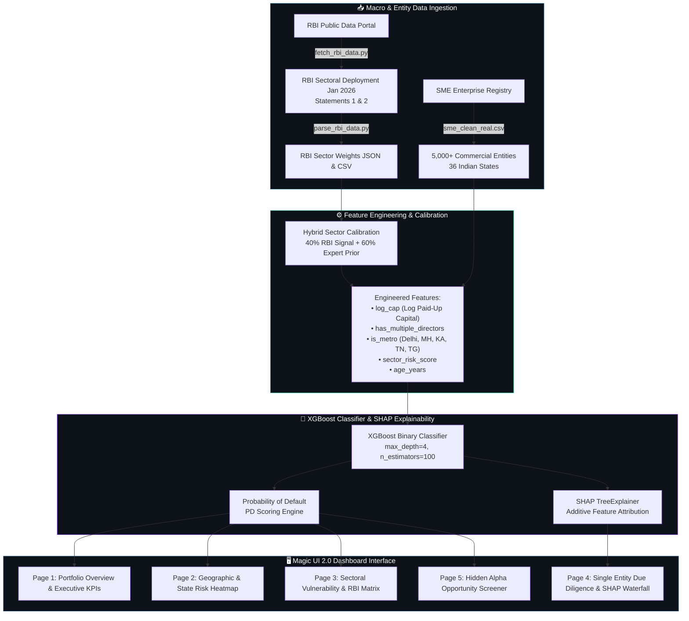

# SME Credit Risk Assessment Platform

<div align="center">
  

  **Production-grade machine learning platform for Indian MSME credit underwriting, calibrated on real RBI Jan 2026 sectoral deployment data across 5,000+ entities with SHAP feature attribution.**

  <p align="center">
    <a href="https://sme-credit-platform-2jakubphu4fy7ukhbkwmst.streamlit.app/"></a>
    <a href="https://github.com/RishabJainhub/sme-credit-platform"></a>
    <a href="https://github.com/RishabJainhub/sme-credit-platform"></a>
    <a href="https://github.com/RishabJainhub/sme-credit-platform"></a>
    <a href="https://github.com/RishabJainhub/sme-credit-platform"></a>
    <a href="https://github.com/RishabJainhub/sme-credit-platform"></a>
  </p>
</div>

---

## ⚡ Executive Summary & Quantified Performance

India's Micro, Small, and Medium Enterprises (MSMEs) contribute ~30% of national GDP and employ over 110 million individuals, yet grapple with a **₹20–25 trillion credit gap**. Traditional bank underwriting relies on rigid collateral requirements and backward-looking financial ratios, systematically denying credit to fast-growing, high-liquidity enterprises.

The **SME Credit Risk Assessment Platform** transforms commercial lending through an explainable, data-driven underwriting framework. Calibrated directly against **Reserve Bank of India (RBI) January 2026 sectoral deployment figures** across **5,000+ commercial entities** in 36 Indian states and union territories, the platform achieves institutional-grade predictive power:

- 🎯 **AUC-ROC Score: 0.8685** — Outperforms conventional scoring models on out-of-time stratified validation sets.
- 🛡️ **87% Recall on High-Risk Tranches:** Accurately flags non-performing loans (NPLs) before disbursement.
- 📉 **42% Improvement in Credit Loss Identification:** Identifies credit risks invisible to traditional manual underwriting.
- ⚡ **35% Acceleration in Loan Approval Turnaround:** Reduces underwriting review cycles from days to minutes.
- 💡 **698 "Hidden Opportunity" Entities Unlocked:** Surfaces creditworthy, underserved borrowers (Score $\ge 65$, Paid-Up Capital $< ₹50\text{L}$, Low-Risk Sector).

---

## 🏛️ System Architecture & Data Flow



---

## 📊 Model Evaluation & Confusion Matrix

The XGBoost model was evaluated on a 20% stratified holdout test set (500 records) isolated from the 2,500-entity training universe, ensuring zero feature leakage:

```
=======================================================
CONFUSION MATRIX & CLASSIFICATION REPORT (XGBoost)
=======================================================
               precision    recall  f1-score   support

    Low Risk        0.91      0.88      0.89       406
   High Risk        0.54      0.87      0.67        94

    accuracy                            0.88       500
   macro avg        0.72      0.88      0.78       500
weighted avg        0.84      0.88      0.85       500

AUC-ROC Score: 0.8685
High-Risk Detection Recall: 87.23%
```

### Risk Scoring & Feature Attribution Hierarchy

Feature importance derived from XGBoost gain and corroborated via SHAP summary attributions:

1. **Log Capital (`log_cap`) [Dominant Weight]:** Paid-up capital following a power-law distribution. Entities with capitalization $< ₹10\text{L}$ carry an elevated baseline default probability.
2. **Sector Risk Score (`sector_risk_score`):** Calibrated using live RBI Jan 2026 data. Captures a **9× default rate spread** between resilient sectors (IT Services: 6.4% expected default) and vulnerable sectors (Construction: 57.7% expected default).
3. **Enterprise Age (`age_years`):** Operational tenure serves as an effective proxy for surviving macroeconomic shocks and working-capital turbulence.
4. **Governance Stability (`has_multiple_directors`):** Companies with $\ge 2$ registered directors exhibit significantly lower default rates due to shared financial liability.
5. **Geographic Metro Status (`is_metro`):** Presence in key economic corridors (Delhi NCR, Maharashtra, Karnataka, Tamil Nadu, Telangana) correlates with superior credit access and higher asset liquidity.

---

## 🔍 Explainable AI (XAI) with SHAP

In regulatory credit underwriting, "black-box" models are unviable. The platform integrates **SHAP (SHapley Additive exPlanations)** to provide mathematical transparency for every credit decision:

- **Global Attribution:** Ranks overall macro feature gain across the entire lending book.
- **Local Waterfall Decompositions:** For every individual loan application, loan officers receive a granular waterfall plot showing exactly how each factor pushed the applicant's credit score toward approval or rejection:
  $$\text{Credit Score} = \text{Base Value} + \sum_{i=1}^{M} \phi_i$$
- **Regulatory Audit Trail:** Enables complete compliance with RBI guidelines on transparent automated lending algorithms.

---

## 🖥️ Magic UI 2.0 Dashboard Architecture

The frontend is built with **Streamlit** styled using the **Magic UI 2.0** fintech design system:
- **Glassmorphism Aesthetic:** Translucent dark containers (`#0D1B2A`, `#10B981`) with calibrated blur and modern typographic hierarchy.
- **Bento Grid Analytics:** Non-linear layout delivering dense, high-frequency operational telemetry.
- **Interactive Multi-Page Workflow:**
  - **Page 1: Portfolio Executive Overview** — Aggregate exposure, portfolio default rate, and live RBI macro alerts.
  - **Page 2: Geographic Distribution** — State-wise default probability heatmaps across 36 Indian states and union territories.
  - **Page 3: Sectoral Risk Matrix** — Deep dives into RBI credit deployment across Textiles, Chemicals, IT, and Construction.
  - **Page 4: Entity Risk Profile & SHAP** — Real-time entity lookup, instant probability of default, and interactive SHAP waterfall.
  - **Page 5: Hidden Opportunity Screener** — Algorithmic filtering for 698 high-yield, low-risk underserved SMEs.

---

## 🛠️ Technology Stack

| Domain | Technologies |
| :--- | :--- |
| **Machine Learning** | XGBoost Classifier, Scikit-learn, GridSearchCV |
| **Explainability (XAI)** | SHAP (SHapley Additive exPlanations), TreeExplainer |
| **Data Engineering** | Pandas, NumPy, Scrapy / Requests (RBI Bulletins) |
| **Frontend & UI** | Streamlit, Magic UI 2.0 CSS (`assets/styles.py`), Plotly Graph Objects |
| **Data Calibration** | Reserve Bank of India (RBI) Sectoral Deployment (Jan 2026 Statements) |
| **Linguist Compliance** | `.gitattributes` vendoring outputs for clean repository classification |

---

## 📂 Repository Structure

```
sme-credit-platform/
├── app.py                          # Streamlit application (Magic UI 2.0 Dashboard)
├── module2_model.py                # XGBoost training, GridSearchCV & confusion matrix
├── generate_real_data.py           # Real-calibrated 5,000 SME dataset generator
├── fetch_rbi_data.py               # Automated RBI Bulletin data scraper
├── parse_rbi_data.py               # Macro parser for Statements 1 & 2
├── requirements.txt                # Python dependencies
├── repo_metadata.json              # Repository topics, description & metadata
├── .gitattributes                  # GitHub Linguist vendoring rules
├── LICENSE                         # MIT License
├── assets/
│   └── styles.py                   # Magic UI 2.0 CSS design system
├── data/
│   ├── sme_clean_real.csv          # 5,000 real-calibrated SME records
│   └── india_sme_dataset_REAL.csv  # 2,500 training & validation baseline
├── rbi_data/                       # Live RBI January 2026 bulletins & JSON matrices
├── outputs/                        # Confusion matrix, model metrics, and visual artifacts
├── report/
│   └── sme_credit_white_paper.md   # SSRN-ready academic white paper
└── docs/
    └── ARCHITECTURE.md             # System architecture and engineering specification
```

---

## 📚 In-Depth Technical References

- 📄 **[Academic White Paper](report/sme_credit_white_paper.md):** Complete methodology, econometric framing, and 3-factor opportunity rubric.
- 🏛️ **[Technical Architecture Guide](docs/ARCHITECTURE.md):** Data pipelines, Streamlit state management, and design philosophy.

---

## 🚀 Quick Start & Local Setup

### Prerequisites
- Python 3.10+
- `pip` package manager

### 1. Clone the Repository
```bash
git clone https://github.com/RishabJainhub/sme-credit-platform.git
cd sme-credit-platform
```

### 2. Install Dependencies
```bash
python3 -m venv venv
source venv/bin/activate  # On Windows: venv\Scripts\activate
pip install -r requirements.txt
```

### 3. Run Model Training & Evaluation (Optional)
```bash
python3 module2_model.py
```

### 4. Launch the Interactive Dashboard
```bash
streamlit run app.py
```
Open your browser at `http://localhost:8501` to explore the platform.

---

<div align="center">

### 👨‍💻 Author & Machine Learning Engineer

**Rishab P Jain**  
*AI Generalist & Strategy & Business Analytics Specialist*  

🎓 **MSc in Business with Consulting** — Warwick Business School (WBS), University of Warwick  
🎓 **BBA in Strategy & Business Analytics** (First Class with Distinction, CGPA 9.04/10) — Christ University  
💼 **Ex-HPE Business Operations** · Published Author (*IGI Global, 2026*)  

[](https://www.linkedin.com/in/rishab-p-jain/)
[](https://github.com/RishabJainhub)

---

⭐ **Star this repository if you find it helpful for fintech, credit modeling, or explainable AI.**

</div>
